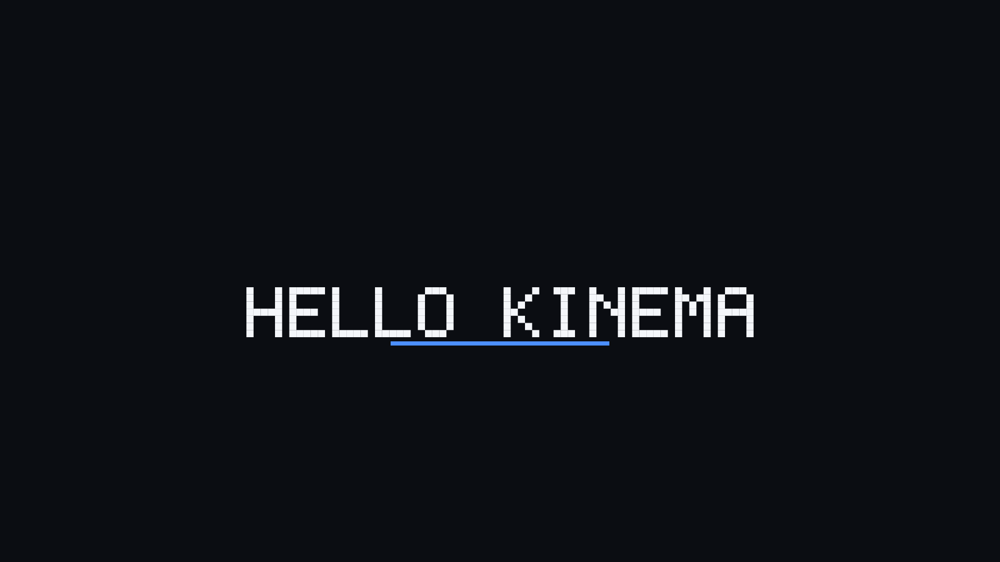

# Kinema

Headless motion engine for AI agents. CLI `kin`, crates `kinema-*`.

There is no human UI and won't be one. Every surface is a tool call, a schema, or a
checkable result.

## Design

Code-first engines render a *projection of code*; After Effects renders a *document*.
Agents write code well but can't inspect it, and patch documents well. So Kinema keeps
one typed document, offers code frontends, and evaluates it in one deterministic pass.

- Calls are stateless: everything reconstructs from the document plus the op journal.
- Writes are CAS-versioned (`--expect-version`) so several agents can work on one project.
- Output is compact JSON, with `--fields` for projection.
- Errors are `{code, message, hint, fix_op, doc}` and `fix_op` is directly applicable.
- Every op carries a `reason`, so a critic agent can audit another agent's work.

## What it takes from where

| Source | Taken |
| --- | --- |
| RAEA (FSL, docs only) | browserless GPU frames, NV12 → hardware encode, dependency-tracked incremental bake, timeline as queryable data |
| HyperFrames (Apache-2.0) | declarative timing, seek-don't-play determinism, nested comps, typed ops + undo, the skill contract |
| Remotion | composition registry, input props, frame-pure render, chunked resumable render, parallel encode |
| After Effects | precomps, bezier easing, expressions, mattes, adjustment layers, time remap, motion blur, shape ops, text animators, Essential Properties |
| Blender | ID datablocks with linking, depsgraph, node graphs as data, modifier stack, AOV/EXR/OCIO |

The craft layer — type, colour, motion, audio and the detector suite — is what makes
output look professional rather than generated.

The approved plan is kept verbatim in [`docs/PLAN-ORIGINAL.md`](docs/PLAN-ORIGINAL.md);
[`docs/PLAN.md`](docs/PLAN.md) expands it and records what is built against it.

## Status: P0

Built:

- `kinema-time` — rational frame rate, 90 kHz tick timeline, timecode.
- `kinema-expr` — the expression language: no loops, no assignment, no I/O, bounded
  source, depth and steps, with `t`, `frame`, easing, springs, deterministic noise and
  `link()` into any other property.
- `kinema-doc` — the document, properties (`value | kf | expr | link | graph`), typed ops
  with inverses, and an append-only journal.
- `kinema-deps` — canonical JSON and content hashes for documents, layers and frames.
- `kinema-text` — real faces, bundled: measurement, kerning, line layout, alignment and
  antialiased glyph rasterisation, with licence and attribution carried as data.
- `kinema-type` — the modular scale, optical tracking and leading, and pairings that come
  with a reason and a role assignment.
- `kinema-palette` — one accent plus a tinted neutral ramp, built in OKLCH, gamut-mapped,
  with a measured proof for every pair that carries meaning.
- `kinema-raster` — CPU RGBA canvas, blend modes, real type, motion blur by subframe
  integration, PNG out.
- `kinema-checks` — the first craft detectors with `fix_op` remedies.
- `kinema-cli` — `kin` itself, including asset records with looked-up licences and
  `undo` driven by the journal's stored inverses.

The document supports `solid`, `text` and `shape` layers; properties support constants,
keyframes, links and expressions. `graph` returns a typed `not-implemented` with a hint
that names the phase. Text is set in real bundled faces, each OFL-1.1 with its licence
text beside it in `assets/fonts`: **Lato** (400, 700, real italic), **Space Mono** (400,
700), **PT Serif** (400, 700, real italic), **Abril Fatface** (display) and **Bebas Neue**
(condensed display). `kin fonts` lists them with attribution, and `TYPE-FAKE` reports a family,
weight or italic the bundle does not actually ship — there is no synthetic oblique and no
invented 500.

A 1920×1080 frame with the starter's motion blur costs 81 ms in release (8 subframes),
and a 60-frame sequence renders at 71 ms per frame including its PNG and manifest. Three
things bought that: an opaque full-canvas solid is a memcpy rather than two million
composited pixels, glyph coverage is cached per face, character and size, and each of the
five bundled faces is parsed only when a document actually sets it. Pixels are unchanged:
the golden hash did not move.

Re-rendering a sequence only redraws frames whose identity changed: a frame is hashed
from the layers actually on screen at that instant, so editing an off-screen layer keeps
its frames. `kin verify --render` re-renders a manifest and compares pixels, which is the
reproducibility claim stated as a command.

Not built yet: GPU raster, media decode, encode, audio, assets, capture, templates, MCP.
Each returns a typed `not-implemented` error with a hint rather than pretending.

A document can state its design system once, in `look`: one accent, dark or light, the
type scale and a pairing. `kin look` resolves it into tokens with proofs, a ladder and a
pairing reason, lists any drift, and hands back a `set-look` op ready for `kin apply`. From
then on `TYPE-SCALE` measures against the document's own scale and `LOOK-DRIFT` reports a
chromatic colour more than 25° off the accent hue, with the accent as the remedy.

Text carries a staggered entrance of its own: `text.anim` is `reveal` or `rise`, per
character, word or line, with its own stagger, duration and easing, evaluated on the
layer's clock. The starter uses it, so the letters resolve left to right without the
project asking for it.

`kin type` publishes the modular scale an agent should be choosing from, with optical
tracking and leading per step, and `kin typeface recommend "<brief>"` turns a brief into a
pairing with a stated reason plus a role assignment. `TYPE-SCALE` closes the loop: a size
off the scale is a defect with the step to snap to, and more than four sizes is reported
with no remedy, because choosing which size to drop is a directing call.

Solids and shapes take a gradient (`set-gradient`, linear or radial, with stops), mixed
in linear light and optionally dithered. A ramp that holds one colour for more than 16 px
is a `BANDING` defect whose `fix_op` turns dithering on — measured, not assumed: the demo
ramp that trips it holds one colour for 92 px of a 1920 px span.

A layer can be cut to another layer through `set-mattes`, by alpha or by luma, in canvas
space so the matte layer's own transform decides where it cuts. The layer doing the cutting
is a source and does not draw itself; `kin render` says so in `matte_sources`, because a
layer disappearing quietly is the failure this feature invites. The same trap bites from the
other side: a matte whose source ink does not reach the layer produces an empty region, not
an error, so `kin probe` both bboxes before wondering where the picture went.

Modifiers are applied, not ignored, and `set-modifier` gives them the same typed op and
inverse as everything else. `blur` softens the layer itself, premultiplying colour first
so a soft edge does not pick up the colour of the transparent pixels next to it;
`drop-shadow` lays the same silhouette down and to the right of the layer, under it; `glow`
blurs the layer's own coverage and adds it to the frame as light under the layer, working only over the layer's box grown by its radius
so a 40 px glow costs what a 40 px box costs rather than what the canvas costs (652 ms a
frame before that crop, 119 ms after). Any other modifier type is an error naming the
layer, because a look produced by a modifier must not render as if it were never there.

`create-comp` makes a comp (with layers, if you have them) and `delete-comp` takes one
away; each is the other's inverse, so a deleted comp comes back with its layers rather
than empty. A comp layer (`"kind": "comp"`, `"source": "<comp id>"`) draws another comp
in its own frame: the layer's start is the nested comp's zero, its position is where the nested frame
sits, and its bbox is the nested comp's size. A comp that contains itself is an error with
the delete-layer that breaks it, not a stack overflow. Nested comps render without the
parent's motion blur, because shutter belongs to the comp being rendered.

Detectors live in this build: `TYPE-FAKE`, `TYPE-SCALE`, `LOOK-DRIFT`, `BANDING`, `READ`,
`CHROMA`, `PALETTE`, `EASE-FLAT`, `SHUTTER`, `HOLD-NONE` and `STAGGER`. All but `HOLD-NONE` ship a `fix_op`, and `kin check --fix`
applies them to a fixpoint: remedies are measured against one snapshot, so CHROMA's
remedy and READ's can disagree, and only re-measuring after each step settles it. The
remaining detectors are specified with their thresholds in `docs/PLAN.md` and land with
the features they measure.



`kin new demo` then `kin render --frame 30`: the CPU tier's first still. The title and the
rule both carry bezier keyframes, the three entrances are staggered, and `kin check` is
clean.

## Usage

```sh
kin new demo                     # scaffold a project
kin capabilities                 # what this build can do
kin schema                       # JSON Schema for the document
kin apply --project demo --ops ops.json --expect-version 0
kin probe --project demo --at 1.0    # evaluated layer state at a time
kin eval 'sin(t * 2) * 40' --at 0.5  # one expression, on its own
kin render --project demo --frame 30 -o demo/f30.png
kin check --project demo         # craft defects with fix_op remedies
kin check --project demo --fix   # apply them until nothing fixable is left
kin credits --project demo       # licence summary and release gate
kin log --project demo           # the op journal
kin fonts                        # bundled families, weights, licence and attribution
kin type                         # the modular scale with optical spacing
kin typeface recommend "a technical developer video about data"
kin palette --accent '#3b82f6' --scheme dark   # roles with contrast proofs
kin look --project demo          # the stated look, resolved, plus drift and a ready op
kin asset add still.png --project demo --spdx cc-by-4.0 --source-url <url> --author <name>
kin undo --project demo          # replay the journal's inverses
kin verify --project demo --manifest demo/frames/manifest.json --render
kin render --project demo --frames 0-59 -o demo/frames   # sequence + hash manifest
kin apply --project demo --ops -  <<<'{"op":"set-prop","path":"comp:main/shutter","value":180,"reason":"film default"}'
kin render --project demo --frames 0-59 -o demo/frames   # only changed frames redraw
```

Every verb prints JSON. Errors carry `code`, `message`, `hint`, `fix_op` and `doc`:

```json
{"ok":false,"error":{"code":"version-conflict","message":"document is at version 4, you expected 0","hint":"rebase: reload with `kin probe`, re-read the value, and retry with the current version","fix_op":null,"doc":"docs/PLAN.md#contract"}}
```

## Build

```sh
cargo build --release
cargo test
```

## Licence

MIT OR Apache-2.0. No GPL code is linked; x264/x265 stay behind an opt-in feature, and
Blender is only ever invoked as a subprocess.
